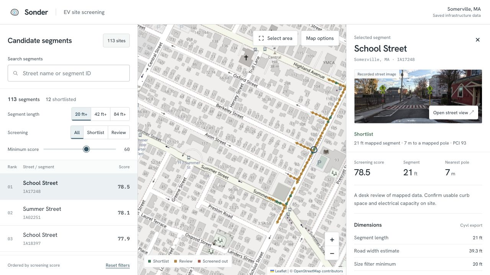
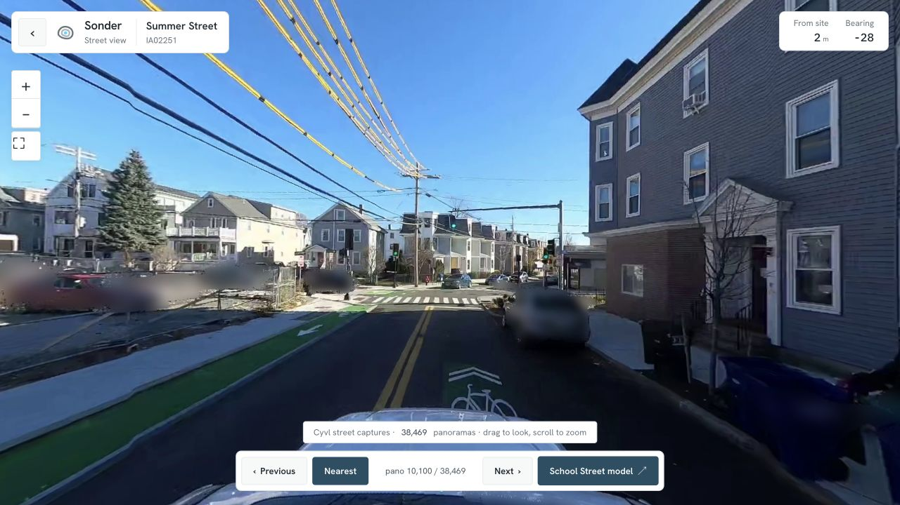

# Sonder | EV Charger Site Screening

Compare potential curbside EV charger locations using saved Somerville infrastructure data.

The browser apps have been retired. Screenshots, saved street captures, screening code, survey services, and the CAD pipeline remain in this repository.



Map data © [OpenStreetMap contributors](https://www.openstreetmap.org/copyright).



## Quick Start

Run the existing screening and survey checks with Python 3.11+:

```bash
git clone https://github.com/Smokeybear10/208.PROJ.sonder.git
cd 208.PROJ.sonder
python3 -m venv .venv
source .venv/bin/activate
pip install -r screening/requirements.txt -r survey/requirements.txt -r swarm/requirements.txt httpx
python -m pytest tests/ survey/tests/ --import-mode=importlib -q
```

Generate a report from the saved survey fixtures without an API key:

```bash
ANTHROPIC_API_KEY= python -m survey.run_demo --pdf out/survey_report.pdf
```

The optional live survey path requires `ANTHROPIC_API_KEY`. See [`screening/`](screening/) for spatial screening and [`cad/`](cad/) for LiDAR processing and model exports.

## Data and Scope

The saved dataset includes 456 street segments derived from the Cyvl infrastructure export. Scores compare geometry, nearby mapped assets, and road-marking proxies. They do not establish charger fit, electrical capacity, installation cost, or payback.

Recorded street captures and detection overlays provide evidence for a desk review. Usable curb space, accessibility, restrictions, utility capacity, and permits still need verification on site.

## Tech Stack

| Layer | Tools |
| --- | --- |
| Spatial processing | Python, GeoPandas, Shapely |
| Survey services | FastAPI, Claude |
| Reports | ReportLab |
| CAD exports | PDAL, OBJ/MTL, Autodesk APS |

## Project Structure

```text
assets/screenshots/  # Preserved screenshots of the former apps
demo/                # Saved segment data, street captures, indexes, and brand mark
screening/           # Spatial features and scoring
survey/, swarm/      # Site-review services and reports
perception/          # Street-capture analysis
cad/                 # LiDAR-to-CAD pipeline, APS integration, coordinate utilities
platform_export/     # Source GIS layers
```

Built by Thomas Ou, Aarav Raina, Sayem Kamal, and Maximus Rome at the Cyvl Physical AI Hackathon.
